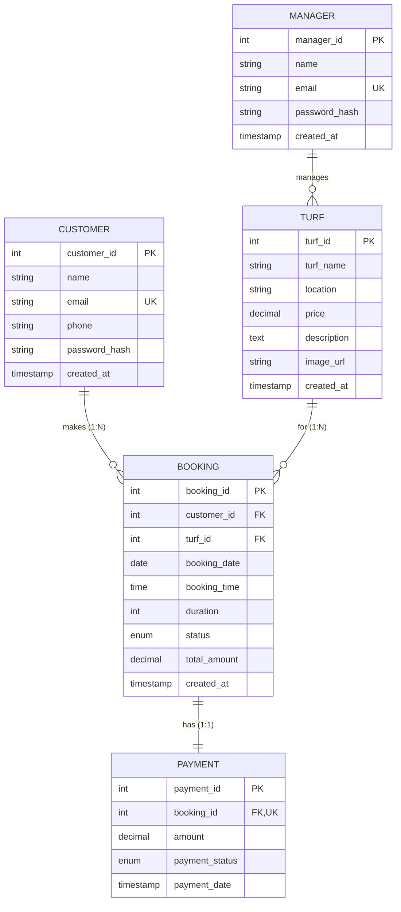

# Football Turf Management System

A full-stack, database-driven web application for managing and reserving football turfs, designed and implemented strictly in accordance with the **College DBMS Mini-Project Synopsis**.

Built with **HTML5, CSS3, Vanilla JavaScript (ES6+), Node.js, Express.js, and SQLite (better-sqlite3)** with local zero-setup persistent storage, ACID-compliant transaction management, foreign key integrity, and row-level conflict prevention.

---

## 👥 Student Project Team Details

| Sr. No | Roll No | Name of Student | Academic Year |
|---|---|---|---|
| 1 | **24CE126** | **Gavril Anthony Barreto** | Third Year T.E. (Computer Engineering) |
| 2 | **24CE128** | **Jayden Ansall Fernandes** | Third Year T.E. (Computer Engineering) |
| 3 | **24CE125** | **Gavin Troy Fernandes** | Third Year T.E. (Computer Engineering) |

---

## ⚡ Zero-Setup Portability (Run on Any Windows PC)

**No external database server is required!** 
- ❌ No MySQL server installation
- ❌ No XAMPP / Apache / PHP
- ❌ No cloud database or paid services
- ❌ No manual SQL file importing or table creation

The application uses an embedded, high-performance relational database engine (**SQLite 3** via `better-sqlite3`). The database:
- Resides in a local project file: `database/turf.db`.
- **Auto-initializes on first launch**: automatically creates tables and seeds sample records if empty.
- Persists all customer registrations, turfs, bookings, and payments across restarts.
- Works 100% offline without requiring an internet connection once dependencies are installed.

---

## 🚀 Simple 2-Step Startup

### Step 1: Install Dependencies
Open a terminal in the project directory:
```bash
npm install
```

### Step 2: Start the System
```bash
npm start
```

That's it! Open your browser and navigate to:
👉 **`http://localhost:3000`**

---

## 📌 Project Objectives & Functional Modules

1. **Customer Operations:**
   - Account registration with Bcrypt cryptographic password hashing.
   - Browse football turfs with location details, pitch dimensions, and hourly prices.
   - Live time-slot availability checking (06:00 to 23:00).
   - Conflict-free slot booking backed by ACID transaction isolation.
   - Customer dashboard showing upcoming matches and booking references.
   - Complete booking history with payment status tracking and booking cancellation.

2. **Manager Operations:**
   - Dedicated Administrative Dashboard with high-level KPI cards (Customers, Turfs, Bookings, Gross Revenue).
   - Full Turf CRUD operations (Create, Read, Update, Safe Delete).
   - Booking management (Filter by date/turf/status; update booking status to CONFIRMED, COMPLETED, or CANCELLED).
   - Customer directory with lifetime bookings count and spending metrics.
   - Turf usage and revenue report (Aggregated hours booked and revenue generated per facility).
   - Real-time Slot Occupancy Monitor.

3. **College DBMS Demonstration Page (`/database-overview.html`):**
   - Live entity record counts and table schema inspections.
   - Actual table records viewer directly from SQLite (passwords masked).
   - Live interactive execution of 9 core DBMS SQL concepts:
     1. **3-Table INNER JOIN** (`CUSTOMER` ⋈ `BOOKING` ⋈ `TURF`)
     2. **GROUP BY & Aggregates** (`COUNT`, `SUM`, `AVG`)
     3. **ORDER BY Multi-Column Sorting**
     4. **Statistical Aggregate Functions** (`MIN`, `MAX`, `AVG`, `SUM`, `COUNT`)
     5. **Primary Key & Foreign Key Referential Integrity Traversal**
     6. **Relational Selection & Projection with WHERE Predicates**
     7. **Data Manipulation Language (DML) - INSERT**
     8. **Data Manipulation Language (DML) - UPDATE**
     9. **Safe DELETE with Foreign Key Referential Integrity Protection**
   - Interactive SQL Console for examiners to run custom queries directly.

---

## 🗄️ Database Architecture & Relational Schema

### Database File: `database/turf.db`

The database schema strictly follows the original college mini-project ER Diagram and Schema Diagram:



### Constraints & Referential Integrity:
- `PRAGMA foreign_keys = ON;` is enforced on every database connection.
- `PRAGMA journal_mode = WAL;` (Write-Ahead Logging) ensures robust transaction performance.
- Cascading deletes and update triggers preserve referential integrity across `CUSTOMER`, `TURF`, `BOOKING`, and `PAYMENT`.

---

## 🛡️ Concurrency & Overlapping Slot Prevention (ACID Rule)

A core requirement of this DBMS project is preventing two users from reserving the same turf facility during overlapping time windows on the same date.

### Transaction Implementation:
The system uses SQLite atomic transactions (`BEGIN IMMEDIATE ... COMMIT / ROLLBACK`):

```sql
SELECT booking_id, booking_time, duration, status
FROM BOOKING
WHERE turf_id = ?
  AND booking_date = ?
  AND status != 'CANCELLED'
  AND (
    ? < time(booking_time, '+' || duration || ' hours')
    AND time(?, '+' || ? || ' hours') > booking_time
  );
```

**Interval Overlap Principle:**
Two time intervals $[S_1, E_1)$ and $[S_2, E_2)$ overlap if and only if:
$$\max(S_1, S_2) < \min(E_1, E_2) \iff S_1 < E_2 \land E_1 > S_2$$

If any overlapping row exists, the transaction immediately aborts, rolls back, and returns an HTTP `409 Conflict` error to the client.

---

## 🔑 Demo & Examiner Credentials

Testing accounts pre-seeded in the database:

### 1. Turf Manager (Administrative Access):
- **Email:** `manager@turf.com`
- **Password:** `manager123`
*(Full access to manager dashboard, turf CRUD, bookings administration, and DBMS demonstration page).*

### 2. Customer Accounts:
- **Email:** `demo@example.com` | **Password:** `customer123`
- **Email:** `jayden@example.com` | **Password:** `customer123`
- **Email:** `john@example.com` | **Password:** `customer123`

*(Quick-fill buttons are provided on the login page for convenience during college presentations).*

---

## 📂 Project Directory Structure

```text
football-turf-management/
├── backend/
│   ├── config/
│   │   └── db.js                 # SQLite connection & auto-initializer (better-sqlite3)
│   ├── controllers/
│   │   ├── authController.js     # Register, login, session handlers
│   │   ├── turfController.js     # Public list & manager CRUD
│   │   ├── bookingController.js  # ACID booking engine & overlap prevention
│   │   ├── managerController.js  # KPI stats, customer records, usage reports
│   │   └── dbmsDemoController.js # Examiner SQL demonstrations & schema inspection
│   ├── middleware/
│   │   └── auth.js               # Role-based authorization middleware
│   ├── routes/
│   │   ├── authRoutes.js
│   │   ├── turfRoutes.js
│   │   ├── bookingRoutes.js
│   │   ├── managerRoutes.js
│   │   └── dbmsRoutes.js
│   └── server.js                 # Main Express server entry point
│
├── database/
│   ├── turf.db                   # Local persistent SQLite database file
│   ├── schema.sql                # Complete SQLite DDL: CREATE TABLE, PK, FK, INDEX
│   ├── seed.sql                  # Complete SQLite DML: Sample Turfs, Users, Bookings
│   └── init.js                   # Manual reset script (optional)
│
├── frontend/
│   ├── assets/                   # Vector logo & turf pitch illustrations
│   ├── css/
│   │   └── style.css             # Unified sports booking styling
│   ├── js/
│   │   ├── api.js                # Fetch client, sessions & toast notifications
│   │   ├── main.js               # Home page logic & featured turfs
│   │   ├── auth.js               # Login & customer registration
│   │   ├── turfs.js              # Turf catalog & filters
│   │   ├── booking.js            # Slot selection & live cost calculator
│   │   ├── customer.js           # Customer dashboard & booking history
│   │   ├── manager.js            # Manager dashboard & turf CRUD
│   │   └── dbms.js               # DBMS examiner demonstrator & SQL console
│   ├── index.html                # Home page
│   ├── login.html                # Role-based login
│   ├── register.html             # Customer registration
│   ├── turfs.html                # Turf listing
│   ├── booking.html              # Booking page with live slot grid
│   ├── customer-dashboard.html   # Customer dashboard
│   ├── booking-history.html      # Filterable customer booking history
│   ├── manager-dashboard.html    # Turf Manager dashboard
│   └── database-overview.html    # DBMS demonstration page for examiner
│
├── scripts/
│   └── verify-logic.js           # Automated verification test suite (npm test)
├── .env                          # Local environment settings
├── .env.example                  # Template configuration file
├── package.json                  # Node dependencies and scripts
└── README.md                     # Comprehensive documentation
```

---

## 🧪 Running Automated Tests

To run the verification test suite:
```bash
npm test
```
Validates SQL schemas, seed integrity, bcrypt password authentication, interval overlap mathematics, and all frontend assets.
