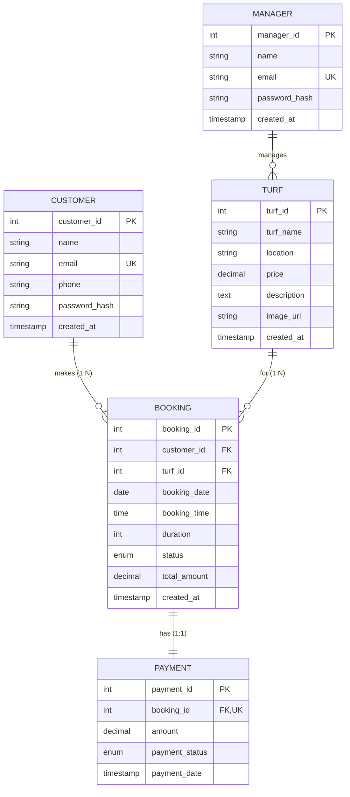

# Football Turf Management System

A full-stack, database-driven web application for managing and reserving football turfs, designed and implemented strictly in accordance with the **College DBMS Mini-Project Synopsis**.

Built with **HTML5, CSS3, Vanilla JavaScript (ES6+), Node.js, Express.js, and MySQL (InnoDB Engine)** with ACID-compliant transaction management and row-level conflict prevention.

---

## 👥 Student Project Team Details

| Sr. No | Roll No | Name of Student | Academic Year |
|---|---|---|---|
| 1 | **24CE126** | **Gavril Anthony Barreto** | Second Year B.E. (Computer Engineering) |
| 2 | **24CE128** | **Jayden Ansall Fernandes** | Second Year B.E. (Computer Engineering) |
| 3 | **24CE125** | **Gavin Troy Fernandes** | Second Year B.E. (Computer Engineering) |

---

## 📌 Project Objectives & Scope

1. **Customer Operations:**
   - Account registration with Bcrypt password hashing.
   - Browse football turfs with location details, pitch dimensions, and hourly prices.
   - Live time-slot availability checking (06:00 to 23:00).
   - Conflict-free slot booking backed by MySQL concurrency locking.
   - Customer dashboard showing upcoming matches and booking references.
   - Complete booking history with payment status tracking and booking cancellation.

2. **Manager Operations:**
   - Dedicated Administrative Dashboard with high-level KPI cards (Customers, Turfs, Bookings, Gross Revenue).
   - Full Turf CRUD operations (Create, Read, Update, Safe Delete).
   - Booking management (Filter by date/turf/status; update booking status to CONFIRMED, COMPLETED, or CANCELLED).
   - Customer directory with lifetime bookings count and spending metrics.
   - Turf usage and revenue report (Aggregated hours booked and revenue generated per facility).
   - Real-time Slot Occupancy Monitor.

3. **College DBMS Demonstration Page (`/database-overview.html`):**
   - Live entity record counts and table schema inspections.
   - Actual table records viewer directly from MySQL (passwords masked).
   - Live interactive execution of 9 core DBMS SQL concepts:
     1. **3-Table INNER JOIN** (`CUSTOMER` ⋈ `BOOKING` ⋈ `TURF`)
     2. **GROUP BY & Aggregates** (`COUNT`, `SUM`, `AVG`)
     3. **ORDER BY Multi-Column Sorting**
     4. **Statistical Aggregate Functions** (`MIN`, `MAX`, `AVG`, `SUM`, `COUNT`)
     5. **Primary Key & Foreign Key Referential Integrity Traversal**
     6. **Relational Selection & Projection with WHERE Predicates**
     7. **Data Manipulation Language (DML) - INSERT**
     8. **Data Manipulation Language (DML) - UPDATE**
     9. **Safe DELETE with Foreign Key Referential Integrity Protection**
   - Interactive SQL Console for examiners to run custom queries directly.

---

## 🗄️ Database Architecture & Relational Schema

### Database: `football_turf_management`

The database schema strictly follows the original college mini-project ER Diagram and Schema Diagram:



### Table Definitions & Constraints:
- **`CUSTOMER`**: Stores registered customer credentials and contact information. `email` has a `UNIQUE` constraint. Passwords stored using `bcrypt` (10 rounds).
- **`MANAGER`**: Administrative users with access to dashboard analytics and facility management.
- **`TURF`**: Physical football facilities. Stores turf name, location address, and hourly rate (`DECIMAL(10, 2)`).
- **`BOOKING`**: Associative entity between `CUSTOMER` and `TURF`. Includes `booking_date` (DATE), `booking_time` (TIME), `duration` (INT in hours), `status` (ENUM: CONFIRMED, COMPLETED, CANCELLED, PENDING), and `total_amount`. Indexed on `(turf_id, booking_date, status)` for rapid concurrency lookups.
- **`PAYMENT`**: 1-to-1 relationship with `BOOKING`. Maintains financial audit log, transaction amount, and status (PAID, REFUNDED, PENDING).

---

## 🛡️ Concurrency & Overlapping Slot Prevention (ACID Rule)

A core requirement of this DBMS project is preventing two users from reserving the same turf facility during overlapping time windows on the same date.

### Backend Transaction Implementation:
The system uses MySQL InnoDB row-level locking (`SELECT ... FOR UPDATE`) within an atomic transaction:

```sql
SELECT booking_id, booking_time, duration, status
FROM BOOKING
WHERE turf_id = ?
  AND booking_date = ?
  AND status != 'CANCELLED'
  AND (
    ? < ADDTIME(booking_time, SEC_TO_TIME(duration * 3600))
    AND ADDTIME(?, SEC_TO_TIME(?)) > booking_time
  )
FOR UPDATE;
```

**Interval Overlap Principle:**
Two time intervals $[S_1, E_1)$ and $[S_2, E_2)$ overlap if and only if:
$$\max(S_1, S_2) < \min(E_1, E_2) \iff S_1 < E_2 \land E_1 > S_2$$

If any overlapping row exists, the transaction immediately rolls back and returns an HTTP `409 Conflict` error to the client. If free, both `BOOKING` and `PAYMENT` rows are inserted atomically before committing.

---

## 🛠️ Technology Stack

- **Frontend:**
  - HTML5 & CSS3 (Custom sports turf palette: dark green `#0F3E22`, light green `#22C55E`, charcoal `#111827`, white)
  - Vanilla JavaScript (ES6+ Modules, Fetch API, Async/Await)
  - Responsive design (Desktops, laptops, tablets, mobile)
- **Backend:**
  - Node.js & Express.js (REST API architecture)
  - `mysql2/promise` (Connection pooling & parameterized queries)
  - `bcrypt` (Cryptographic password hashing)
  - `express-session` (Role-based session authorization)
  - `dotenv` (Environment variable configuration)
- **Database:**
  - MySQL Server (InnoDB Storage Engine)

---

## 🚀 Setup & Installation Instructions

### Prerequisites:
1. **Node.js** (v18.0.0 or higher recommended)
2. **MySQL Server** (v8.0 or MariaDB v10.4+) installed and running locally on port `3306`.

### Step 1: Clone or Copy Project Directory
Open a terminal in the project root directory:
```bash
cd "Football Turf Management"
```

### Step 2: Install Node Dependencies
```bash
npm install
```

### Step 3: Configure Environment Variables
Copy `.env.example` to `.env`:
```bash
copy .env.example .env
```
Open `.env` and verify your MySQL connection settings:
```env
PORT=3000
DB_HOST=localhost
DB_USER=root
DB_PASSWORD=your_mysql_password_here
DB_NAME=football_turf_management
DB_PORT=3306
```
*(If your MySQL root user has no password, leave `DB_PASSWORD=` blank).*

### Step 4: Initialize Database (Schema & Seed Data)
Run the automated database initializer:
```bash
npm run db:init
```
This script connects to your MySQL server, creates the `football_turf_management` database, executes `database/schema.sql`, and populates sample records from `database/seed.sql`.

*Alternative manual import via MySQL CLI / Workbench:*
```bash
mysql -u root -p < database/schema.sql
mysql -u root -p < database/seed.sql
```

### Step 5: Start the Application
```bash
npm start
```
Open your browser and navigate to:
👉 **`http://localhost:3000`**

---

## 🔑 Demo & Examiner Credentials

The seed data comes pre-loaded with testing accounts for both roles:

### 1. Turf Manager (Administrative Access):
- **Email:** `manager@turf.com`
- **Password:** `manager123`
*(Full access to manager dashboard, turf CRUD, bookings administration, and DBMS demonstration page).*

### 2. Customer Accounts:
- **Email:** `gavril@example.com` | **Password:** `customer123`
- **Email:** `jayden@example.com` | **Password:** `customer123`
- **Email:** `john@example.com` | **Password:** `customer123`

*(You can also register any new customer account directly from the `/register.html` page).*

---

## 📂 Project Directory Structure

```text
football-turf-management/
├── backend/
│   ├── config/
│   │   └── db.js                 # mysql2 connection pool & transaction runner
│   ├── controllers/
│   │   ├── authController.js     # Register, login, session handlers
│   │   ├── turfController.js     # Public list & manager CRUD
│   │   ├── bookingController.js  # ACID booking engine & overlap prevention
│   │   ├── managerController.js  # KPI stats, customer records, usage reports
│   │   └── dbmsDemoController.js # Examiner SQL demonstrations & schema inspection
│   ├── middleware/
│   │   └── auth.js               # Role-based authorization middleware
│   ├── routes/
│   │   ├── authRoutes.js
│   │   ├── turfRoutes.js
│   │   ├── bookingRoutes.js
│   │   ├── managerRoutes.js
│   │   └── dbmsRoutes.js
│   └── server.js                 # Main Express server entry point
│
├── database/
│   ├── schema.sql                # Complete DDL: CREATE TABLE, PK, FK, INDEX
│   ├── seed.sql                  # Complete DML: Sample Turfs, Users, Bookings
│   └── init.js                   # Node.js automated database setup script
│
├── frontend/
│   ├── assets/                   # Vector logo & turf pitch illustrations
│   ├── css/
│   │   └── style.css             # Unified sports booking styling
│   ├── js/
│   │   ├── api.js                # Fetch client, sessions & toast notifications
│   │   ├── main.js               # Home page logic & featured turfs
│   │   ├── auth.js               # Login & customer registration
│   │   ├── turfs.js              # Turf catalog & filters
│   │   ├── booking.js            # Slot selection & live cost calculator
│   │   ├── customer.js           # Customer dashboard & booking history
│   │   ├── manager.js            # Manager dashboard & turf CRUD
│   │   └── dbms.js               # DBMS examiner demonstrator & SQL console
│   ├── index.html                # Home page
│   ├── login.html                # Role-based login
│   ├── register.html             # Customer registration
│   ├── turfs.html                # Turf listing
│   ├── booking.html              # Booking page with live slot grid
│   ├── customer-dashboard.html   # Customer dashboard
│   ├── booking-history.html      # Filterable customer booking history
│   ├── manager-dashboard.html    # Turf Manager dashboard
│   └── database-overview.html    # DBMS demonstration page for examiner
│
├── .env.example                  # Template configuration file
├── .env                          # Local environment settings
├── .gitignore                    # Git ignore file
├── package.json                  # Node dependencies and scripts
└── README.md                     # Comprehensive documentation
```

---

## 🌐 Complete REST API Reference

| Method | Endpoint | Access | Description |
|---|---|---|---|
| `POST` | `/api/auth/register` | Public | Register customer account |
| `POST` | `/api/auth/login` | Public | Login customer or manager |
| `POST` | `/api/auth/logout` | Logged In | Clear user session |
| `GET` | `/api/auth/me` | Public | Check current session user |
| `GET` | `/api/turfs` | Public | Browse turfs with search/filters |
| `GET` | `/api/turfs/:id` | Public | Get single turf details |
| `POST` | `/api/turfs` | Manager | Create new turf facility |
| `PUT` | `/api/turfs/:id` | Manager | Update turf info / price |
| `DELETE` | `/api/turfs/:id` | Manager | Safe delete turf with constraint check |
| `GET` | `/api/bookings/availability` | Public | Check available 1-hr slots for turf & date |
| `POST` | `/api/bookings` | Customer | Create booking with ACID overlap lock |
| `GET` | `/api/bookings/my-bookings` | Customer | Retrieve customer's bookings & payments |
| `PUT` | `/api/bookings/:id/cancel` | Customer | Cancel upcoming booking & mark refunded |
| `GET` | `/api/bookings/all` | Manager | Retrieve all bookings with filters |
| `PUT` | `/api/bookings/:id/status` | Manager | Update booking status (CONFIRMED/COMPLETED/CANCELLED) |
| `GET` | `/api/manager/stats` | Manager | Retrieve high-level KPI dashboard metrics |
| `GET` | `/api/manager/customers` | Manager | Retrieve registered customer spending records |
| `GET` | `/api/manager/usage-report` | Manager | Retrieve turf utilization & revenue report |
| `GET` | `/api/dbms/overview` | Manager | Database metadata and entity table counts |
| `GET` | `/api/dbms/table/:table` | Manager | Live table records with masked passwords |
| `POST` | `/api/dbms/demo` | Manager | Execute preset DBMS SQL demonstrations |
| `GET` | `/api/health` | Public | Server and MySQL connection health |

---

## 💻 Portability: Running on Another Computer

To run this project on any other college lab computer or laptop:
1. Ensure **Node.js** and **MySQL Server** are installed.
2. Copy the entire `Football Turf Management` folder.
3. Open a terminal in the folder and run `npm install`.
4. Update `.env` with that computer's MySQL credentials.
5. Run `npm run db:init` to automatically generate the database and seed records.
6. Run `npm start` and visit `http://localhost:3000`.

No global system dependencies, paid cloud services, or computer-specific absolute paths are required.
